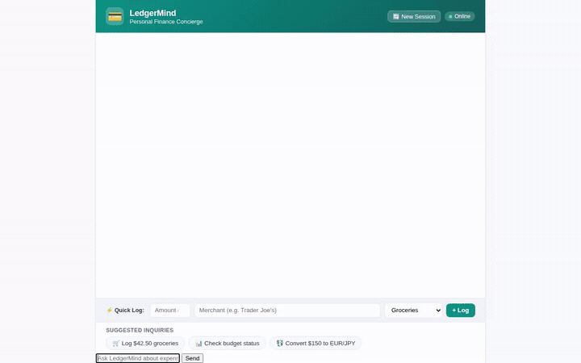

# 💳 LedgerMind — Personal Finance & Expense Tracker Concierge

> A conversational financial concierge agent built on Google Cloud Agent Platform, ADK, and Gemini. LedgerMind helps individuals log expenses, monitor monthly budgets, convert international currencies, discover nearby retail stores, and visualize financial milestones with generated badges and videos.

<div align="center">



</div>

---

## 🌟 Capabilities & Features

Based directly on the implementation in [`app/agent.py`](app/agent.py), LedgerMind provides:

- 💳 **Expense Logging & Ledger Tracking**: Record expenses with merchant name, amount, category, date, payment method, and notes into persistent storage (`log_expense`).
- 🔍 **Expense History & Filtering**: Query and filter historical transactions sorted by date or filtered by category (`list_expenses`).
- 📊 **Spending Analytics**: Compute overall expenditures, total transaction volume, and category-by-category subtotals (`get_spending_summary`).
- 🎯 **Category Budget Management**: Set, update, and monitor monthly spending caps per category, calculating remaining allowances and over-budget warnings (`manage_category_budget`).
- 💱 **Real-Time Currency Conversion**: Convert foreign currency expenditures into USD/EUR/GBP/JPY using live exchange rates via open ExchangeRate-API (`convert_currency`).
- 📍 **Store & Merchant Geolocation**: Resolve merchant physical locations to latitude/longitude (`geocode_address`) and locate nearby businesses like supermarkets, restaurants, banks, or cafes via Google Maps Places API (`find_nearby_places`).
- 🏅 **Visual Achievement Badges**: Generate 3D achievement badges for financial savings milestones using `gemini-3.1-flash-lite-image`, automatically saving them as session artifacts and uploading to public Cloud Storage (`generate_finance_badge`).
- 🎬 **Celebratory 3D Video Milestones**: Synthesize short 3D motion animations for financial milestones using Google's Omni model (`gemini-omni-flash-preview`), saving to session artifacts and uploading to public Cloud Storage (`generate_finance_video`).
- 🧪 **Secure Financial Math Sandbox**: Run arbitrary Python calculations and projections via Agent Engine Code Execution sandbox (`AgentEngineSandboxCodeExecutor`).

---

## ☁️ Google Cloud Services & Architecture

| Component | Powered By | Implementation Details |
|---|---|---|
| **Core Reasoning Agent** | **ADK + Gemini 3.6 Flash** (`gemini-3.6-flash`) | ADK ReAct loop with HTTP retry policies and system prompt guidance. |
| **Long-Term Memory** | **Agent Platform Memory Bank** | Cross-session memory via `PreloadMemoryTool` and `generate_memories_callback` (`add_session_to_memory`). |
| **Structured Database** | **Google Cloud Firestore** | Native collection references (`expenses`, `budgets`) storing structured transactions. |
| **Object & Blob Storage** | **Google Cloud Storage (GCS)** | Public media bucket storing generated milestone badges (`badges/`) and videos (`videos/`). |
| **Image Generation** | **Vertex AI Imagen / Flash-Lite Image** (`gemini-3.1-flash-lite-image`) | Milestone badge generation with base64 decoding and artifact persistence. |
| **Video Generation** | **Vertex AI Omni** (`gemini-omni-flash-preview`) | High-resolution 3D animation generation using the global interactions API. |
| **Code Execution Sandbox**| **Vertex AI Agent Engine Sandbox** | Isolated remote Python sandbox executing projections and calculations. |
| **Rich Display UI** | **A2UI 0.8** (`a2ui-agent-sdk`) | Structured Card, Row, Column, Text, and Image UI elements. |
| **Frontend & Chat Proxy** | **FastAPI + A2A Protocol** | Async browser chat UI communicating with the deployed agent via `a2a-sdk`. |

---

## 📋 Roadmap Status

- [x] Firestore transaction persistence (`log_expense`, `list_expenses`, `get_spending_summary`)
- [x] Category budget limit checks (`manage_category_budget`)
- [x] Live exchange rate conversions (`convert_currency`)
- [x] Google Maps Places & Geocoding integration (`geocode_address`, `find_nearby_places`)
- [x] Milestone badge generation via `gemini-3.1-flash-lite-image`
- [x] Video milestone generation via `gemini-omni-flash-preview`
- [x] Memory Bank long-term preferences persistence
- [x] A2UI rich response rendering & custom styled web frontend
- [ ] *Planned, not yet implemented*: Gemini Vision OCR for automatic physical receipt image scanning.
- [ ] *Planned, not yet implemented*: Recurring subscription ghost-detector and cancellation concierge.

---

## 🚀 Setup & Local Run Instructions

### Prerequisites

- Python 3.11+
- `uv` package manager (`curl -LsSf https://astral.sh/uv/install.sh | sh`)
- Google Cloud SDK (`gcloud`) authenticated with application default credentials:
  ```bash
  gcloud auth login
  gcloud auth application-default login
  ```

### 1. Install Dependencies

```bash
# From the ledgermind directory:
uv sync
```

### 2. Environment Configuration

Create a `.env` file or export your Google Cloud configuration:

```bash
export GCP_PROJECT_ID="your-gcp-project-id"
export GCS_BUCKET_NAME="your-media-bucket-name"
export AGENT_ENGINE_RESOURCE_NAME="projects/<project-number>/locations/<region>/reasoningEngines/<id>"
export AGENT_DIRECTORY="app"
```

### 3. Run the Agent Playground

To interact directly with the ADK agent, test tools, and inspect artifacts:

```bash
uv run agents-cli playground
```

### 4. Run the Web Frontend & Proxy

To launch the LedgerMind web interface:

```bash
cd frontend
uv run python main.py
```

The frontend server will start and bind locally to port 8080.
